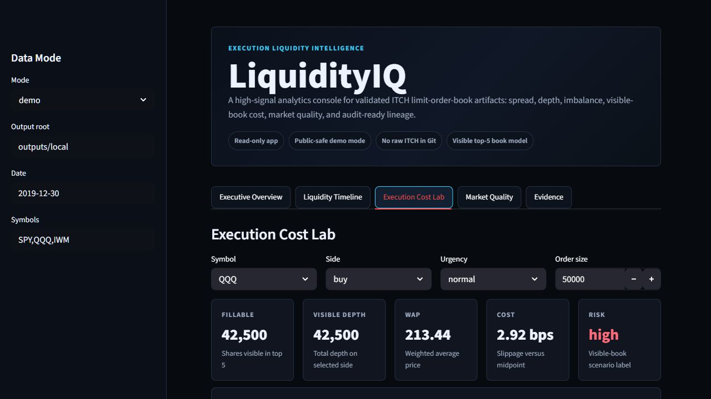
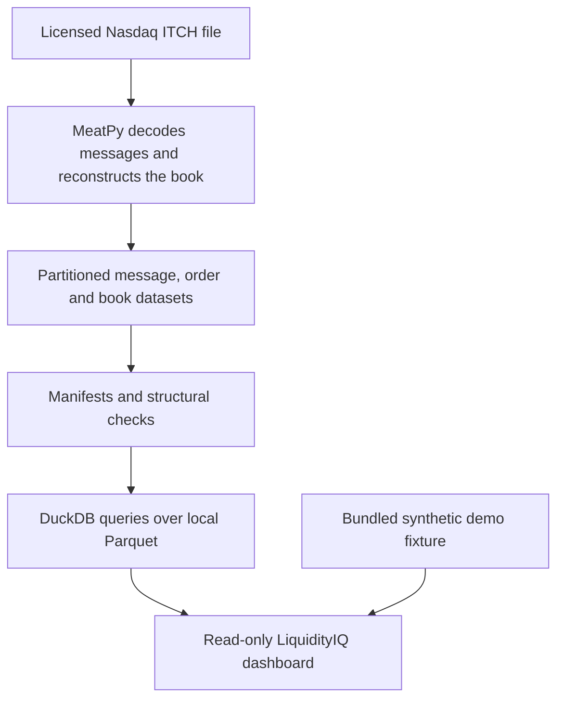

# HPC Market Data Engineering Pipeline for Reliable ITCH Processing

[](https://github.com/HetAshar13/itch-data-pipeline/actions/workflows/ci.yml)

Nasdaq records an order arriving, changing or disappearing as a message. This
pipeline turns those messages into snapshots of the buy and sell orders visible
at each price. MeatPy reconstructs the order book. Python writes the snapshots to
Parquet, checks them, and makes them available to query with DuckDB.

On the University of Luxembourg’s Iris cluster, the full SPY run scanned
29,156,757 feed messages and produced 614,578 snapshots. Its manifest records
the end of the input file, and all eight structural checks passed.
[Open the run evidence](reports/final_evidence_report.md).

## Buying 50,000 shares in LiquidityIQ

A 50,000-share QQQ buy finds 42,500 shares across the five best asks in the
bundled demo (6,500 + 7,500 + 8,500 + 9,500 + 10,500). Those shares have an
estimated weighted average price of $213.44. The remaining 7,500 have no
visible price in this snapshot. [Check the five quantities](data_fixtures/liquidityiq_demo.json).



The Streamlit app reads a synthetic snapshot for this example. The separate
Iris SPY run used licensed market data. Its [run manifest](evidence/lob_spy_until_eof_5406828/lob_manifest_SPY_2019-12-30_until_eof_5406828.json)
records the end of the input file. Its [validation report](evidence/lob_spy_until_eof_5406828/lob_validation_SPY_2019-12-30_until_eof_5406828.json)
records eight checks, including agreement between the manifest and Parquet
row counts and a best bid at or below the best ask in two-sided snapshots.

## At A Glance

| Proof point | Result |
| --- | --- |
| LiquidityIQ | Read-only Streamlit analytics app with public-safe demo mode |
| SPY until-EOF HPC run | `29,156,757` messages scanned, `614,578` LOB snapshots |
| 10M multi-symbol LOB run | `535,626` snapshots across `SPY`, `QQQ`, and `IWM` |
| Message-event dataset | `1,000,000` parsed ITCH message rows |
| Order-event dataset | `796,151` order-event rows |
| Validation | Message, order, and LOB artifacts passed structural/sanity checks |
| Test suite | `138` passing tests |
| Runtime proof | Docker test runtime, GitHub Actions CI, Iris SLURM logs |
| Data safety | Raw Nasdaq data and large Parquet outputs excluded from Git |

## Architecture



Streamlit remains read-only. It reads existing artifacts or tracked aggregate
demo data and does not run extraction, validation, raw ITCH access, SLURM jobs,
or data mutation.

## Engineering decisions

- MeatPy handles exchange message decoding and book reconstruction. The
  pipeline handles extraction, partitioning, validation and analytics.
- Separate message, order and book datasets preserve broad feed coverage and
  give order-event queries a smaller table to read.
- Core datasets preserve the feed's integer prices. LiquidityIQ applies a
  10,000-unit scale for display.
- Manifests, summaries and validation reports let reviewers inspect the Iris
  runs while the licensed feed and generated Parquet stay private.

## Data Products

- `message_events`: broad audit table from parsed MeatPy messages.
- `order_events`: add, cancel, delete, replace, and execution event rows.
- `lob_snapshots`: top-5 bid/ask limit order book snapshots for target symbols.
- `liquidity_bars`: 1-minute liquidity mart used by LiquidityIQ for spread,
  depth, imbalance, event intensity, ratios, scores, and stress labels.

Dataset paths, schemas, validation guarantees, and raw-price policy are
documented in [Data Contracts](docs/DATA_CONTRACTS.md).

## Evidence And Reports

Start here:

- [Portfolio Case Study](reports/portfolio_case_study.md)
- [LiquidityIQ Case Study](reports/liquidityiq_case_study.md)
- [Final Evidence Report](reports/final_evidence_report.md)
- [10M LOB Comparison](reports/lob_10m_comparison.md)
- [Artifact Evidence Index](reports/artifact_evidence_index.md)
- [Curated Evidence Artifacts](evidence/README.md)

## Product Screenshots

[Dashboard overview](reports/linkedin_assets/liquidityiq_overview.png) ·
[Evidence tab](reports/linkedin_assets/liquidityiq_evidence.png)

The curated `evidence/` directory contains SLURM logs, manifests, validation
JSON, and DuckDB summary JSON. It does not contain raw ITCH, `part-000.parquet`,
local `outputs/`, ignored `logs/`, credentials, or private config files.

## Reproducibility

### Local

```powershell
python -m venv .venv
.\.venv\Scripts\Activate.ps1
python -m pip install --upgrade pip
pip install -r requirements.txt
pip install -e .
python -m pytest
python -m itch_data_pipeline.cli healthcheck
```

### Docker

```powershell
docker build -t itch-data-pipeline:test .
docker run --rm itch-data-pipeline:test
docker run --rm itch-data-pipeline:test python -m itch_data_pipeline.cli healthcheck
docker run --rm itch-data-pipeline:test python -m itch_data_pipeline.cli check-raw-data-safety
```

### Iris HPC

HPC execution is documented in the [Operations Runbook](docs/OPERATIONS_RUNBOOK.md).
Jobs are submitted through SLURM scripts under `hpc/`, and only public-safe proof
artifacts are copied back.

## Public Safety

Nasdaq ITCH data is licensed. This repository is designed to be inspectable
without access to the raw feed.

Excluded from Git:

- `data/`
- `outputs/`
- ignored `logs/`
- `.venv/`
- `*.parquet`
- raw `*.gz` files
- private local configs

## Project Docs

- [Data Contracts](docs/DATA_CONTRACTS.md)
- [Reproducibility Guide](docs/REPRODUCIBILITY.md)
- [Operations Runbook](docs/OPERATIONS_RUNBOOK.md)
- [Professor Showcase Guide](docs/PROFESSOR_SHOWCASE_GUIDE.md)
- [Decisions Log](docs/DECISIONS.md)

## Limitations

- Core datasets store ITCH prices as raw integer units; LiquidityIQ adds separate
  display prices using an explicit `10,000` scale.
- Validation is structural plus sanity checking; it does not prove complete market microstructure correctness.
- Multi-symbol comparisons are bounded by message count; only SPY has an until-EOF LOB run.
- Visible-book cost estimates use top-5 displayed depth only; they are not full
  market-impact estimates, trading advice, or alpha signals.
- Large Parquet outputs remain private and are intentionally excluded from Git.
